# Studio UI audit and proportional redesign

This is the historical proportional pass, not the complete workflow audit.
The owner requested a broader review; see the [follow-up audit](uiux-comprehensive-audit.md)
for newly captured error/empty/keyboard/short-viewport states, subsequent fixes and
remaining design work. Its follow-up supersedes the focus, account-toolbar and
form observations below where explicitly recorded.

Date: 2026-10-07. Source baseline: `c3c9eff` (UI unchanged from `fabd1b5`).
Scope: local Studio administration and OAuth consent with disposable fixture data.
Capture: existing runtime Playwright 1.62.1 and installed Chrome; desktop 1280×1000,
touch 390×844. This is same-agent self-checking, not independent review.

## Verdict

The original UI gave utilities too much visual weight on phones and hid important
decisions behind glyphs. The revised interface makes content readable first,
keeps tools compact and labels decisions. It retains the existing palette,
catalog, navigation and account/module boundaries. These are demonstrated local
improvements, not evidence of an award or complete accessibility compliance.

Every design below follows a documented [user story and flow](uiux-flows.md).

## Findings and changes

| Finding and evidence | Change | Story |
| --- | --- | --- |
| Steps 1–3: touch icons measured 24px while body and section headings measured 14px. The large bordered utility faces compete with account identity and state. | Body and section headings use 16px metrics; utility icons use 16px and the catalog's compact touch face inside an unchanged 44px target. | Read readiness; identify the correct account. |
| Steps 3, 5, 6: Save/Cancel and Allow/Deny have no visible words in the baseline. On touch, hover explanations cannot communicate their intent. | These decisions use translated labels and normal catalog Button metrics. Utilities retain named icons. | Save credentials; configure deliberately; authorize deliberately. |
| Step 4: an upgrade is actionable but Review is only a magnifying-glass icon. | Review has visible text. At mobile widths its warning and button stack so the button does not squeeze the explanation. | Review only when a connection has an actionable update. |
| Step 6: baseline hydrated consent preselects every requested permission. | Consent starts unchecked; empty selection refuses submission with an explanation. Existing granular scope submission is retained. | Understand and explicitly choose permissions. |
| Step 1: the runtime path is 12px and ellipsized on phones. | Increase its readable size; preserve full-value copying and intentional truncation in the overview. | Recover from a failure using the correct diagnostic value. |

## Captured steps

1. **Overview — improved, verified locally.** Service, accounts and capabilities
   have readable headings and quiet tools. Stored status remains separate from
   live provider evidence. The mobile first viewport does not show every module;
   the content pane scrolls while the rail remains fixed.

   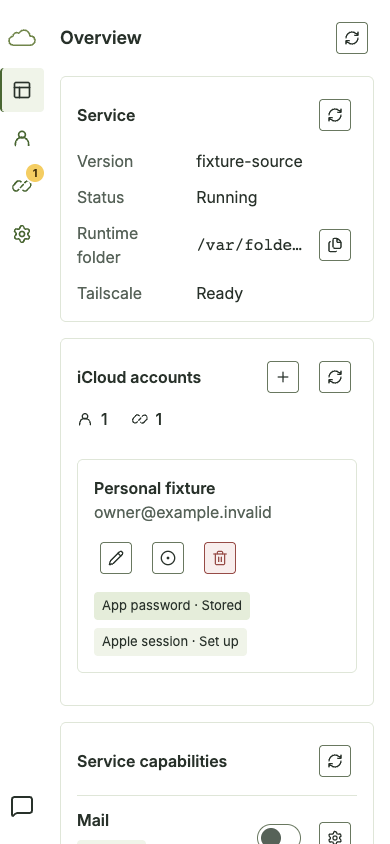

2. **Accounts — improved, verified locally.** Identity leads the card, distinct
   Tags describe credentials and session, and the compact tools sit below identity
   on phones. Icon-only session/edit tools still require learned meanings; their
   accessible names remain available, but touch discoverability is a residual risk.

   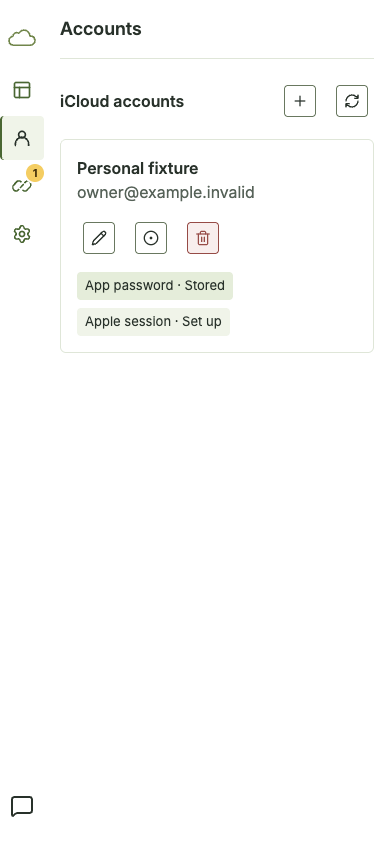

3. **Account dialog — improved, verified locally.** Labels, explanation and
   Verify/Save/Cancel are readable. Existing pending-submit and navigation fencing
   pass. A short-height touch check reaches Cancel by scrolling. Real credential
   and Passkey ceremonies were not exercised.

   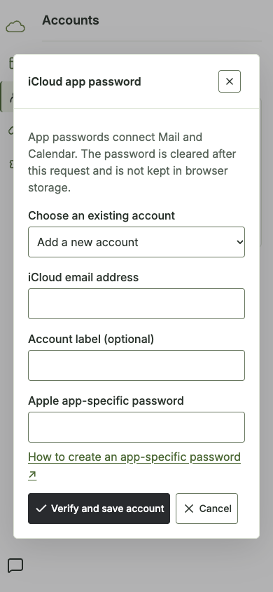

4. **Connections — improved, verified locally.** Client identity, warning and
   grouped existing grants are distinct. Review is labeled and the mobile warning
   wraps without squeezing its copy. Warning count, warning and action retain
   the same actionable predicate. This capture does not prove an external client
   loaded newly authorized tools.

   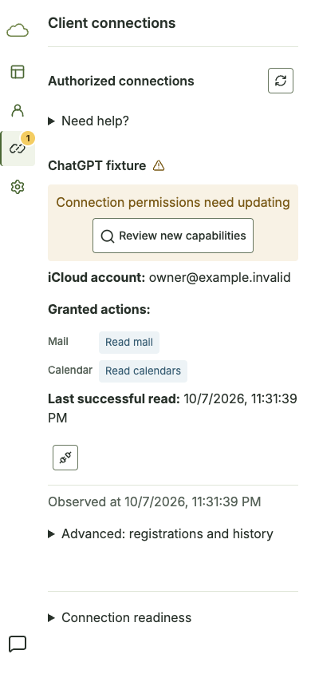

5. **Module settings — improved, verified locally.** Requirements precede actions,
   disabled Save is recognizable and Cancel is explicit. Browser checks verify
   elevation requires unchecked explicit confirmation and persisted readback.
   Native Home/Photos authorization is outside this fixture's evidence.

   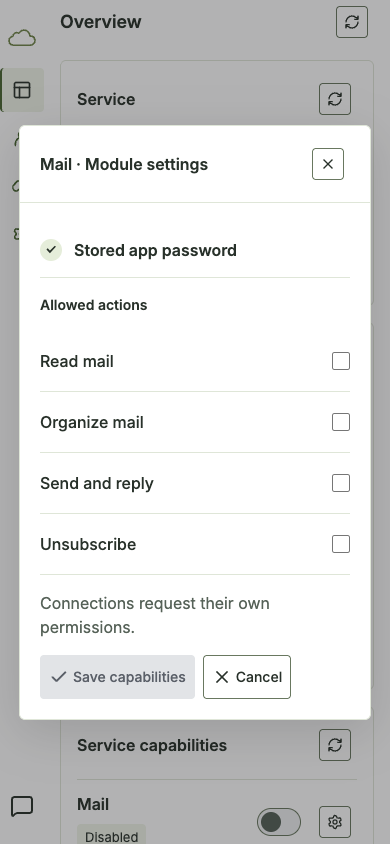

6. **Client consent — corrected, verified locally.** Account/client context and
   permission groups are readable; all requested permissions start unchecked.
   Allow/Deny have visible labels. Selected-scope submission and error feedback
   pass. The entire scrollable page is captured below; it is not a single viewport.

   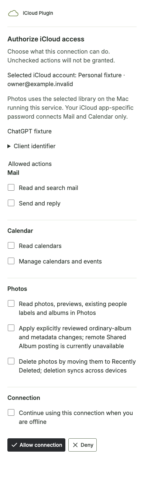

7. **System and recovery — improved, partial visual coverage.** Version is visible,
   diagnostics remain disclosed on demand, and reset entry points have words.
   No reset was performed. Browser fixtures separately check stale-state recovery
   and notification visibility; physical safe-area/keyboard behavior is unverified.

   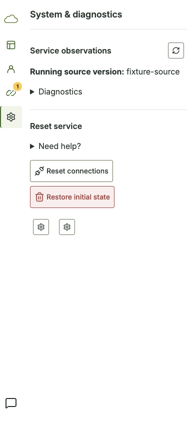

## Baseline comparisons

These are exact inspected screenshots from this run, not generated mockups.

| Screen | Before | After |
| --- | --- | --- |
| Overview | 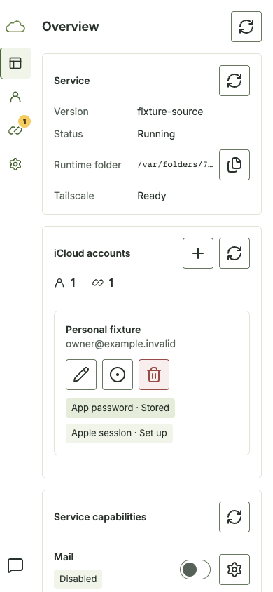 |  |
| Account decision | 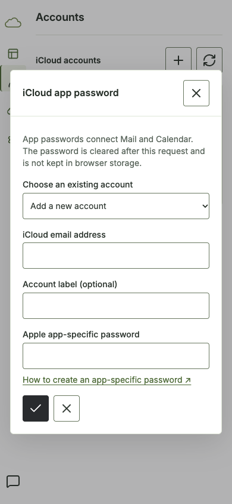 |  |
| Module decision | 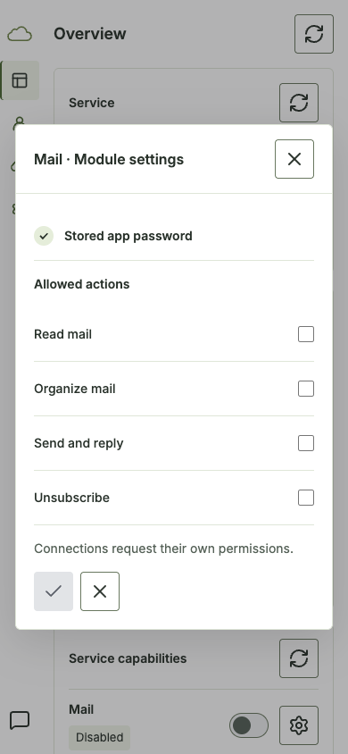 |  |
| Consent | 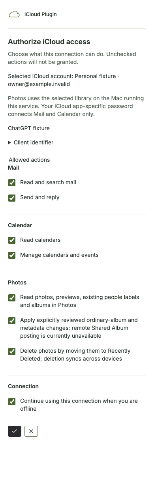 |  |

Desktop composition retains the same fixed rail and available-width content pane:

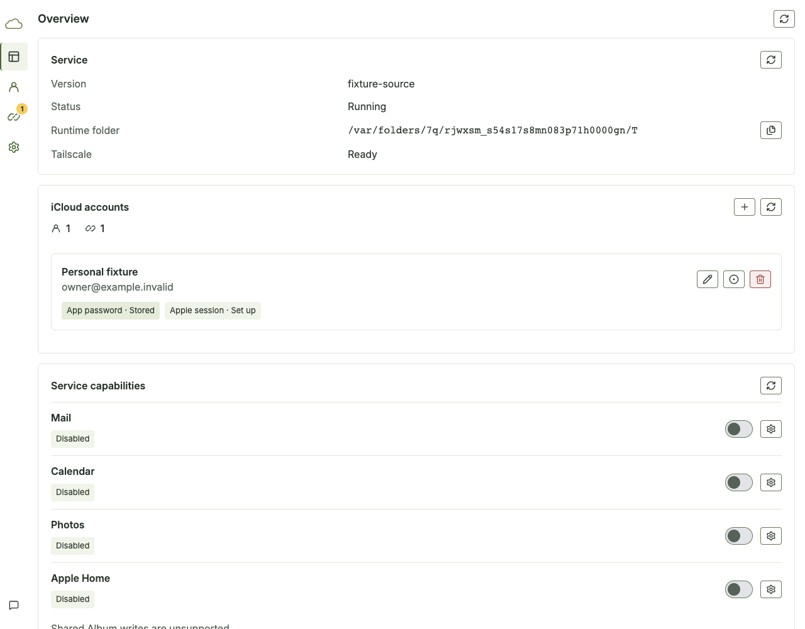

## Accessibility and verification limits

The global owner-selected focus suppression remains in source. Keyboard navigation
tests alone do not establish that focus is visually apparent; resolve that policy
before calling this interface accessible. Some module checkboxes still use legacy
native controls rather than the pinned catalog; a complete form-control adoption
pass remains distinct from this proportional redesign.

This audit does not include a screen reader session, physical iPhone/Safari,
onscreen keyboard, real Passkey, native grants or live external-client acceptance.
The 200% text check covers consent only. Desktop screenshots also show large
available-width sections: further density changes should be tied to real
multi-account tasks and the existing owner-selected content-width behavior.

Build/type checks and 583 unit tests pass. Existing browser checks pass 143
requirement/consent checks and 58 shell checks; eight additional touch checks pass.
No vendor source was changed. No Playwright dependency was added. Preview is
local fixture code, not a deployed or installed release. See
[flow verification](uiux-flows.md#completed-local-verification) for recovery notes.
