# Studio workflow audit: follow-up to the proportional pass

Date: 2026-10-08. Baseline: `2d24f48`. Owner: Studio.

The first [audit](uiux-audit.md) addressed proportions, not the whole experience.
The owner rejected that narrow scope. This follow-up covers task entry, contextual
actions, keyboard operation, short viewports, stale/error states, empty states,
language state, consent and destructive confirmation. It uses newly captured
compiled UI evidence. It is same-agent self-checking, not an independent review.

The preview is a disposable fixture at Tailscale port 8464. It is not the installed
plugin and does not contain real iCloud data. Production deployment and physical
device acceptance have not occurred. The persistent [user flows](uiux-flows.md)
remain the interaction contract.

## Findings, stories and disposition

P1 means a task, recovery or accessible operation is impaired. P2 means a
substantial clarity/consistency issue. P3 is visual polish. These are design
priorities, not a claim of measured conversion or task-time impact.

| ID | Priority | Observed issue | User story and intent | Design / disposition |
| --- | --- | --- | --- | --- |
| F01 | P1 | Blanket CSS removes outlines and shadows from every focused control. Computed keyboard focus is `none`. | As a keyboard user, I want to see my current control so I can navigate and act confidently. | **Fixed:** remove suppression; restore existing catalog focus recipes. Mouse focus does not acquire a permanent decorative frame. |
| F02 | P1 | At 320×320, the credential dialog itself scrolls; content extends far outside its visible bounds and the header can scroll away. | As an owner on a short screen, I want to read a form and always reach its close control so I can leave safely. | **Fixed:** stationary dialog header and independently scrolling, bounded content. |
| F03 | P2 | Account maintenance is represented by pencil, circle-dot and trash glyphs; touch cannot show their hover meaning. | As a multi-account owner, I want readable actions attached to the correct identity so I do not edit or revoke the wrong account. | **Fixed:** a catalog Manage account menu with named credential/session actions and separated removal; existing confirmation remains. |
| F04 | P2 | Desktop service values and account tools sit hundreds of pixels from their labels/identity. | As an owner scanning status, I want each value and action near its context so I can match them without tracing a wide row. | **Fixed:** intrinsic label columns and locally grouped identity/actions. Full-width shell is retained. |
| F05 | P1 | A failed refresh leaves Running/Ready values prominent; stale explanatory prose appears below. | As a troubleshooting owner, I want to know whether status is current so I do not rely on an old observation. | **Fixed:** Last known state catalog Tags at affected Overview section headings; retain old observations and retry controls. |
| F06 | P2 | Module permissions and explicit confirmation use different native label/checkbox composition from the pinned controls. | As an owner choosing capabilities, I want aligned, consistent choices so I can read and select the intended operations. | **Fixed for module settings:** actual pinned Checkbox for capability and consent rows. Other legacy forms remain open work. |
| F07 | P2 | The language entry uses a speech-bubble icon without visible language context. | As an owner switching language, I want to identify the language control without guessing an icon. | **Fixed:** EN / 繁 text trigger using the unchanged catalog Menu. |
| F08 | P2 | Layout reads locale from its own data, but locale was supplied only by page load. Translated page content can coexist with an incorrect locale indicator/selection. | As a bilingual owner, I want the whole shell to agree on the selected language so I can trust the setting. | **Fixed:** supply locale at layout load; verify Traditional Chinese content and trigger together. |
| F09 | P2 | Empty Accounts explains what to do but exposes only a header plus glyph for doing it. | As a new owner, I want an explicit next action beside the empty-state explanation so I can start setup. | **Fixed:** labeled Add an iCloud account action beside the explanation. |
| F10 | P2 | System exposes two identical gear buttons for different setup/permission tasks. | As a troubleshooting owner, I want to distinguish network setup from Photos permission work before opening either. | **Fixed:** visible translated task labels using the catalog action adapter. |
| F11 | P1 | Credential failure notification overlaps bottom dialog decisions in the captured touch state. | As an owner recovering from a rejected credential, I want to read the error and reach Retry/Cancel without dismissing feedback first. | **Fixed:** measure the existing toast region, reserve matching scroll space, and reveal intersecting decisions without moving focus. |
| F12 | P2 | Credential rejection is explained by a toast; fields lack a persistent linked error description. Provider evidence does not identify which member of the email/password pair failed. | As an owner correcting credentials, I want feedback associated with the form so I know how to retry without guessing that one field is definitely wrong. | **Open:** add persistent form-level feedback/descriptions; preserve secret clearing and unknown field attribution. |
| F13 | P2 | Primary navigation is still four icon-only rail entries; the current page title explains only the selected destination. | As a first-time owner on touch, I want to discover Accounts, Connections and System without hovering. | **Open:** explore readable navigation within the owner's fixed-rail and available-width constraints; validate short/touch viewports before adopting. |
| F14 | P2 | Overview starts with version/runtime/network details; account and capability state is spread over several sections without a task-level connect-client next step. | As a new owner, I want to know what prevents connecting my client and what to do next. | **Open:** task-oriented readiness summary and next action, grounded in actual prerequisites; keep diagnostic details available on demand. |
| F15 | P3 | Wide sections and nested account/card borders still give a sparse, repetitive desktop hierarchy. | As an owner scanning several accounts, I want clear grouping with useful density so I can compare identities and states quickly. | **Open:** simplify grouping and test a real multi-account composition; do not silently restore the previously rejected centered shell. |

## Evidence and acceptance

The numbered capture inventory below distinguishes success, failure and limited
coverage. Images are compiled UI captures, not ImageGen concepts. Empty Accounts
is an explicitly injected status response; failure paths use fixture endpoints or
dummy rejected credentials. They are useful UI evidence, not live provider facts.

Acceptance for the repaired slice:

- Existing build/type checks and 583 unit tests pass; Svelte reports zero errors
  and warnings. Vendor controls/tokens are unchanged.
- Existing requirement/consent and shell browser checks pass (143 and 58).
- Additional touch checks cover the named account menu and Escape focus return,
  fixed short-dialog close control, reachable decisions, actual module Checkbox,
  route wrapping, Traditional Chinese locale and absence of browser errors.
- Keyboard outline is restored from `none` to the existing solid recipe.
- At 320×320, scrolling moves modal content while preserving header bounds.
- A failing refresh is explicitly marked Last known state, with retained values.
- Toast/decision overlap is checked after a rejected dummy credential.

This does not establish real iCloud credentials, native Photos/Home grants,
physical Safari/iPhone, onscreen keyboard behavior, screen-reader acceptance or
full accessibility compliance. Unchanged backend policy, explicit unchecked
consent and foreign-origin rejection remain required invariants.

## Remaining design work

F12–F15 are unresolved work, not passing acceptance. A complete experience also
needs multi-account comparison, full legacy Select/FieldLabel adoption, a task-first
onboarding/connection journey, and physical-device error/keyboard checks. The
correct conclusion is a broader audited and repaired slice with named remaining
gaps; it is not an award-level completion claim.

## Captured steps

| Step | Intent / state | Health and limits | Finding / flow | Screenshot |
| --- | --- | --- | --- | --- |
| 1. Overview scanning | Overview scanning | Improved; desktop density still open | F04, F14, F15 | 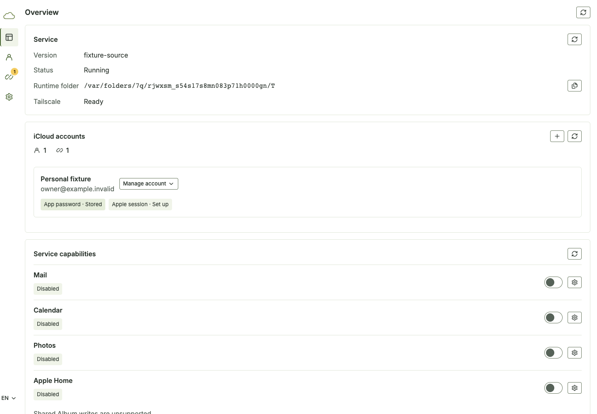 |
| 2. Keyboard entry | Keyboard entry | Visible focus verified | F01 | 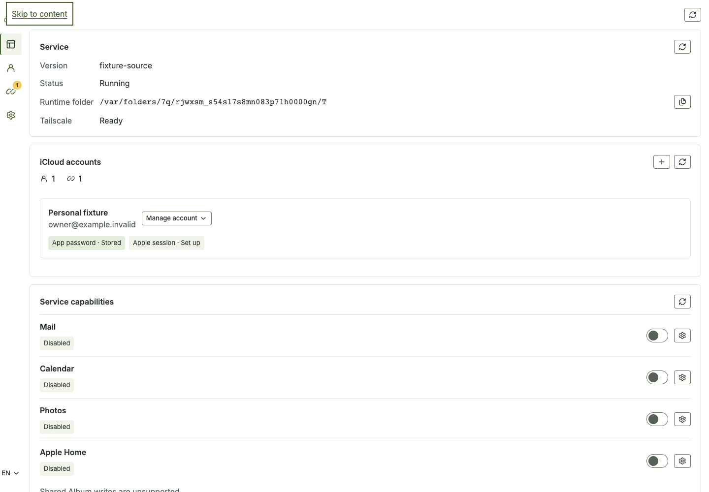 |
| 3. Account context | Account context | Named menu and nearby identity | F03, F04 | 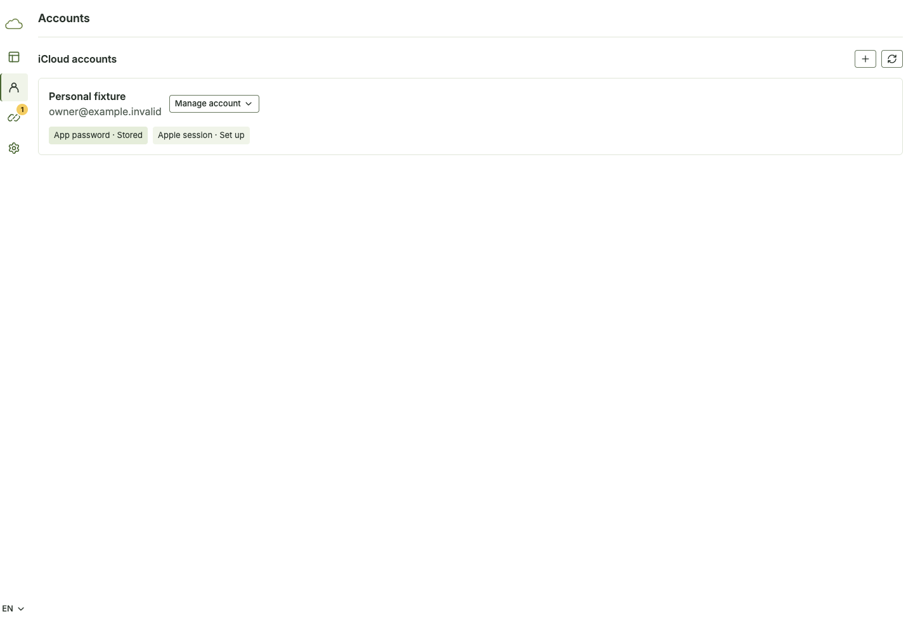 |
| 4. Short-screen credential dialog | Short-screen credential dialog | Stationary header; content scrolls | F02 | 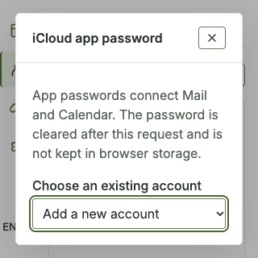 |
| 5. Module capability form | Module capability form | Actual catalog Checkbox; explicit consent retained | F06 | 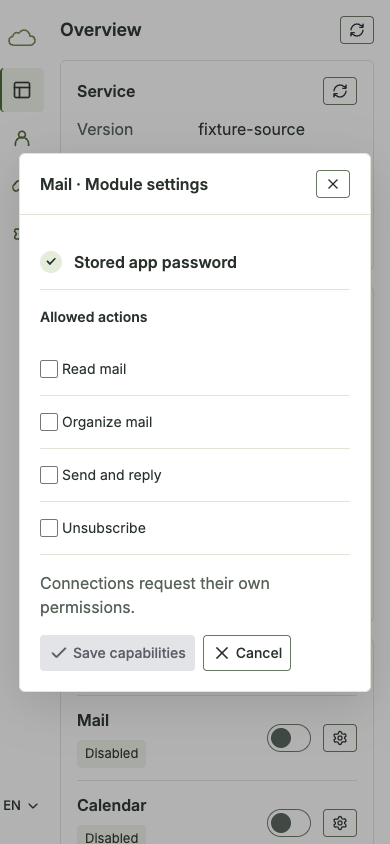 |
| 6. Failed refresh | Failed refresh | Retained values labeled Last known state | F05 | 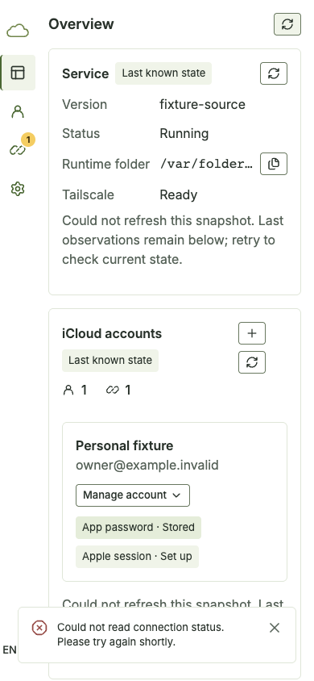 |
| 7. Empty account state | Empty account state | Explicit Add action | F09 | 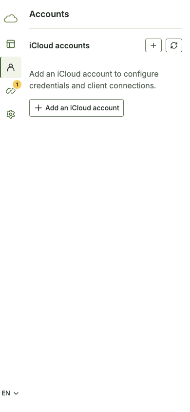 |
| 8. Connection grants | Connection grants | Existing grouped grants retained | F13, F14 | 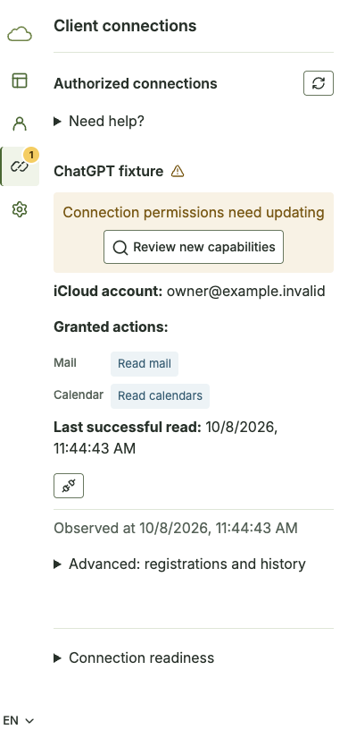 |
| 9. Connection update confirmation | Connection update confirmation | Named decisions; no actual grant update performed | Existing flow 4 | 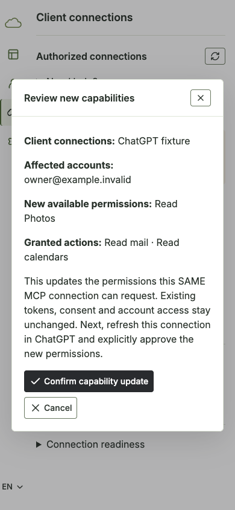 |
| 10. System task entry | System task entry | Distinct task labels | F10 | 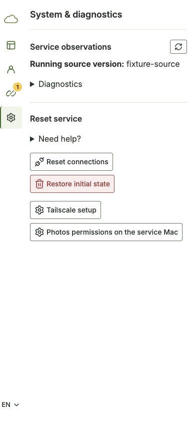 |
| 11. Destructive confirmation | Destructive confirmation | Impact/phrase visible; reset not submitted | Existing flow 6 | 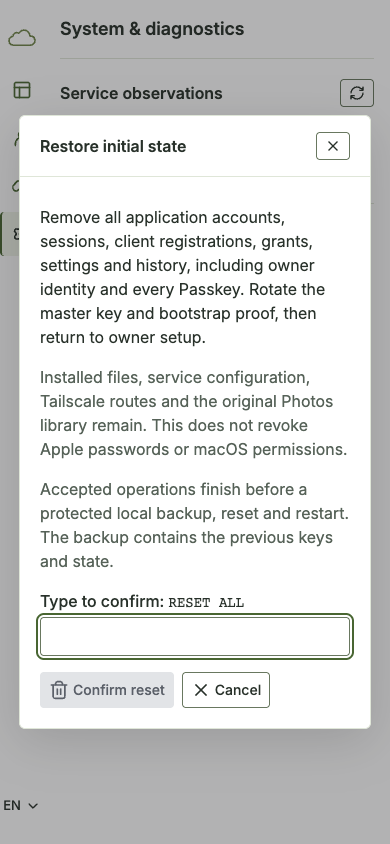 |
| 12. Passkey sign-in entry | Passkey sign-in entry | Visual entry only; real ceremony unverified | Existing flow 5 | 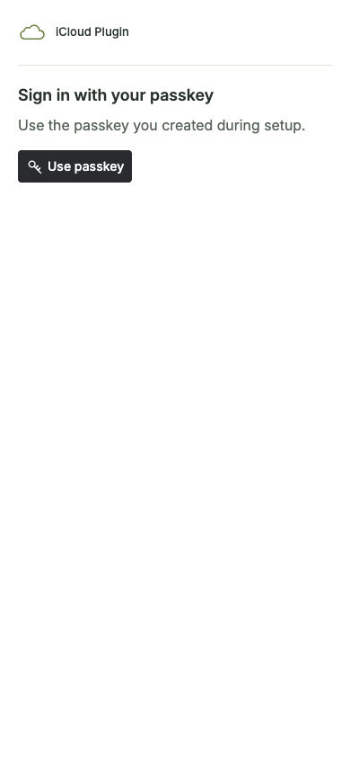 |
| 13. Consent context | Consent context | Readable choices; unchecked on load | Existing flow 5 | 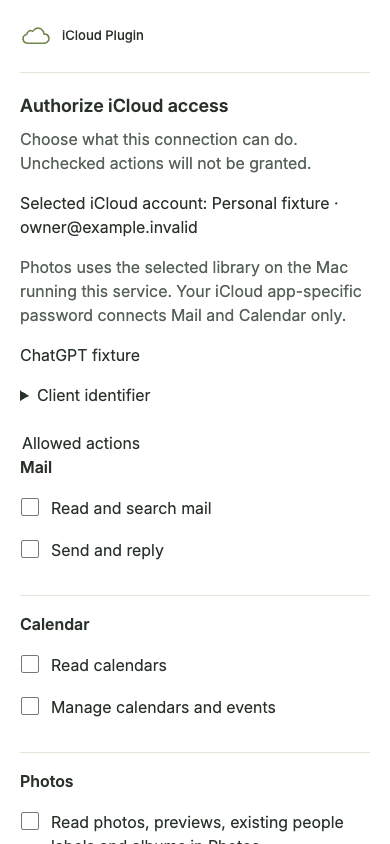 |
| 14. Empty consent error | Empty consent error | Explained refusal; no authorization submitted | Existing flow 5 | 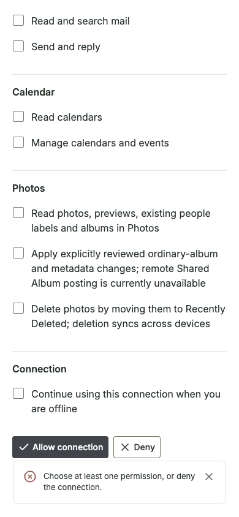 |
| 15. Rejected dummy credential | Rejected dummy credential | Decisions exposed above notification; field linkage still open | F11, F12 | 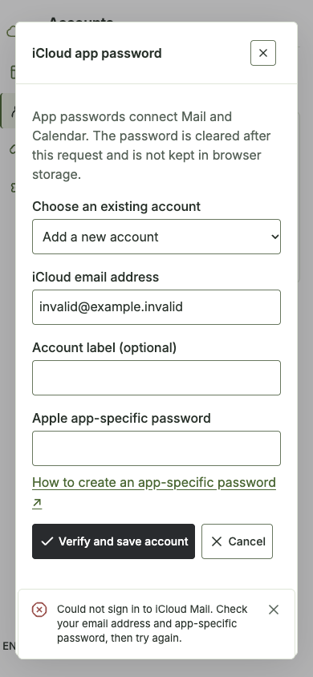 |
| 16. Touch account maintenance | Touch account maintenance | Readable catalog actions and separated removal | F03 | 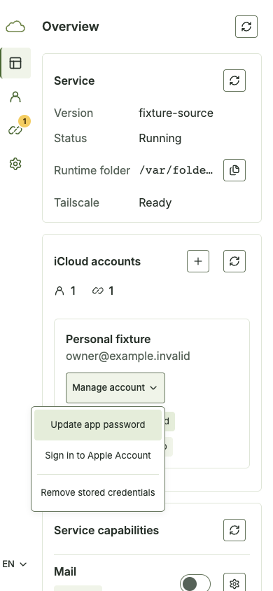 |
| 17. Traditional Chinese shell | Traditional Chinese shell | Language/content agree; no horizontal overflow | F07, F08 | 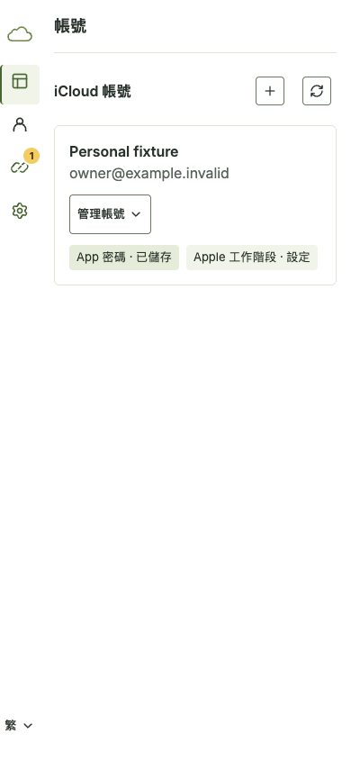 |

## Before/after evidence

| Finding | Baseline | Repaired |
| --- | --- | --- |
| Desktop context | 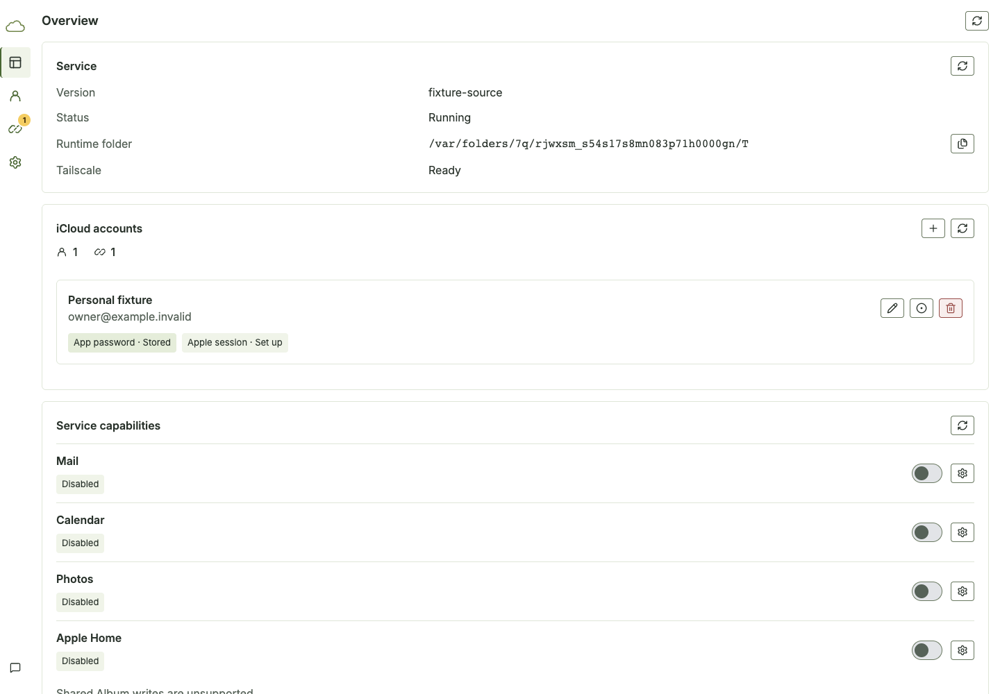 |  |
| Short dialog | 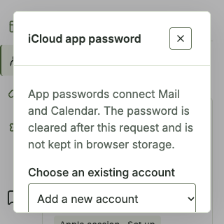 |  |
| Stale confidence | 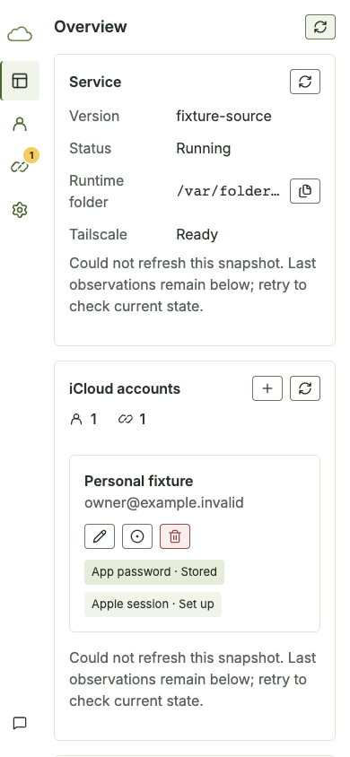 |  |
| Empty state | 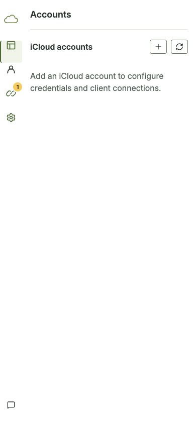 |  |

Final local checks: 583 unit tests; 143 existing requirements/consent browser
checks, 58 shell checks and 17 new recovery checks. The focused tailnet touch/locale
check also passes 14 assertions with no page errors. The rejected-credential capture
measures retry bottom at 696.5px and toast top at 734.05px, with decisions no longer
covered. Secrets still clear after rejection. These measurements describe the
390×844 fixture only.

The new reusable regression entry is
`apps/e2e/browser/uiux-recovery-flow.ts`. It accepts the existing
`--playwright-module`, `--chrome` and `--output` flags and owns a disposable worker.
No project browser dependency was added. Raw transient captures and logs are
reconciled here; accepted images are retained under `docs/assets/uiux-workflow-audit/`.
Local commit and tailnet preview are retained for owner review. No PR, merge,
release or native installation occurred; remote CI and real-client acceptance are
not claimed. The preview process is restarted after rebuild to avoid mixing old
SSR asset references with newly generated client files. An intermediate capture
attempt hit that mismatch and was rejected, not counted as acceptance.
