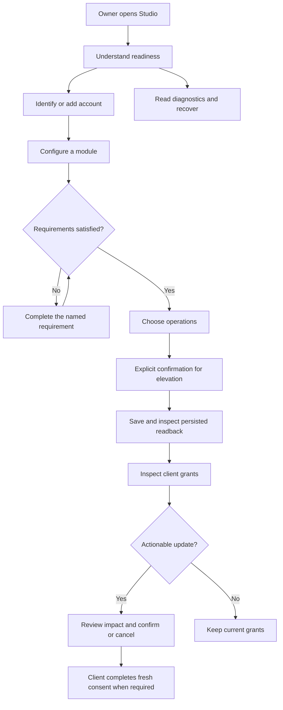

# Studio UI and UX flows

Owner: Studio. Status: source review and proposed acceptance; visual audit pending.

## Goal and design contract

Make everyday setup and management readable, predictable and proportionate. The
owner identified oversized buttons and undersized text. Quality is judged by
successful user tasks, readable content and verified interactions, not an award
claim. Every design change below has a user story and observable acceptance.

Use the adopted [design language](design-language.md) and unchanged
[pinned catalog](../packages/ui/src/design-system/PROVENANCE.md). Reuse existing
routes, translations, permissions, confirmation and persistence behavior. Keep
product composition in Studio and reusable appearance in the shared UI layer.
Do not change authorization, credential handling or installation as design work.

Toolbar tools support these tasks; they are not the main reading hierarchy.
Each decision presents its intent in visible text. Saved state, drafts, pending
operations and failed/stale observations must remain distinguishable.

## Source observations and priority

These are current-source findings, not screenshot findings or installed acceptance.

| Priority | Observation | User impact | Design response |
| --- | --- | --- | --- |
| High | ActionButton uses compact controls, but its consumer CSS expands touch icons to 24px; catalog buttons retain a 44px coarse target. | Small text competes with larger actions, especially on phones. | Use the catalog compact touch appearance with compact icons; retain the 44px hit area. |
| High | Body is 14px, supporting text can be 12px, and section headings are also 14px. | Users must work harder to distinguish identity, section and explanation. | Use the existing 16px heading role for sections and 14px body role for readable help; preserve the 18px page title and 13px catalog tag labels. |
| High | Save, cancel, authorize and destructive actions use the same icon-only adapter as toolbar utilities. | Users must infer consequential intent from a glyph or tooltip, which is unavailable on touch. | Provide visible translated labels for decision actions; keep compact icons for repeated toolbar utilities. |
| Medium | The runtime folder is ellipsized and rendered at 12px. | Users cannot readily inspect the diagnostic value. | Use the catalog body/code role and preserve full-value copy. |
| Open | The shared stylesheet explicitly suppresses all focus outlines under a previously owner-selected policy. | Keyboard focus can be difficult to locate; hints cover only some controls. | Document the risk. Resolve visible-focus policy before claiming keyboard accessibility. |

## 1. Understand service readiness

**Story:** As the installation owner, I want to know whether the service and its
modules are ready so I can decide what needs attention before connecting a client.

**Flow:** Open Overview → read service status → scan accounts → scan Mail,
Calendar, Photos and Home → open the relevant requirement or settings dialog.

**Design:** Section headings lead the eye; status and explanations are readable
body text. Refresh is a compact utility next to its section title. Module state
stays separate from configuration actions. Keep the stable rail and one scrolling
content pane.

**Feedback and recovery:** Initial fetch may show skeletons. Refresh retains the
last observation, shows activity, and reports stale state after failure. Unknown
is visibly distinct from disabled and ready.

**Acceptance:** Module order remains stable; refresh does not collapse loaded
content; no horizontal overflow at desktop and 390px touch widths; content scrolls
without moving the rail; displayed status does not imply live provider acceptance.

## 2. Add or maintain an account

**Story:** As an owner managing multiple accounts, I want to act on the correct
account so I can update credentials without confusing one identity with another.

**Flow:** Open Accounts → identify the account → choose credential/session action,
or Add → read the labeled fields → enter the required values → verify and save.

**Design:** Account identity leads the card; credential and session Tags describe
different stored states. Compact edit, session and add tools retain accessible
names. The dialog's decision actions have visible text and catalog controls.
On phones, identity uses its own row above the tools.

**Feedback and recovery:** Pending submission disables duplicate actions and holds
the dialog. Validation failures preserve correctable context without claiming the
account was saved. Transient secrets clear according to the existing protocol.
Closing restores focus to the initiating action.

**Acceptance:** Long addresses wrap; add and edit actions affect the selected
account; fields have readable labels; save intent is visible without hovering;
pending navigation cannot dismiss an in-flight submission; credentials never appear
in status or diagnostics.

## 3. Configure module capabilities

**Story:** As an owner, I want to understand which operations a module will allow
so I can enable the minimum useful capabilities intentionally.

**Flow:** Open module settings or propose an enable with its switch → complete
missing requirements → inspect capability labels → select operations → explicitly
confirm any elevation → save, or cancel the draft.

**Design:** Requirements precede operations. Checkbox labels and consent are
readable and aligned. Save and Cancel have visible text. The compact switch is a
proposal entry point, while the saved state remains authoritative.

**Feedback and recovery:** Save stays unavailable until prerequisites and explicit
confirmation are satisfied. Failed saves report an error and do not present the
draft as persisted policy. Closing a changed draft retains the existing discard
confirmation.

**Acceptance:** Consent begins unchecked; opening/cancelling does not elevate
permissions; touch controls remain 44px targets with quieter faces; dialog content
and decision controls stay reachable in short mobile viewports; no backend policy
or native permission change is introduced by visual work.

## 4. Review a client connection

**Story:** As an owner, I want to distinguish existing grants from available
updates so I can review a client only when there is an actionable change.

**Flow:** Open Connections → identify client and account → inspect grouped grants
→ open Review when available → read impact → confirm or cancel → inspect readback.

**Design:** Keep module groups and their semantic Tag colors. Place Review beside
the actionable warning with a visible label; warning count, warning area and Review
use the same existing predicate. Revoke/remove confirmation includes the affected
client and impact with readable action labels.

**Feedback and recovery:** Show pending state without duplicate submission. On
failure, retain the last observed grant state. Registration updates, consent and
loaded client tools remain distinct evidence layers.

**Acceptance:** A normal connection has no misleading Review action; long names
and scopes wrap; cancelling changes no grants; successful fixture readback is
reported as fixture evidence, never external-client acceptance.

## 5. Choose an account and consent as a client user

**Story:** As a person connecting a client, I want to see which account and
permissions I am authorizing so I can make an informed, reversible choice.

**Flow:** Sign in → choose account → read client identity and permission groups →
explicitly select permissions → authorize or deny → follow the existing continuation.

**Design:** Use readable account identity and permission labels. Authorize and Deny
have visible translated text instead of unexplained glyphs. Keep a focused reading
width and normal document scrolling on public authentication pages.

**Feedback and recovery:** Preserve existing signed query, safe return destination,
pending behavior, validation and error feedback. Adding an account is distinct from
granting a client access.

**Acceptance:** Consent begins unchecked; identity and scope remain visible; both
decision paths work with keyboard and touch; pending state prevents duplicates;
UI changes preserve OAuth and Passkey semantics.

## 6. Diagnose a problem and understand feedback

**Story:** As an owner troubleshooting a failure, I want useful diagnostics and
clear action results so I can recover without repeatedly submitting the same action.

**Flow:** Open System or the relevant help disclosure → read version/location and
status → copy a full value if needed → perform the intended action → read and dismiss
its notification. For reset, inspect the separate destructive confirmation first.

**Design:** Keep detailed diagnostics in disclosure while primary state remains
visible. Use readable diagnostic values, compact copy tools and labeled destructive
decisions. Reuse catalog Toast appearance and the existing gesture adapter.

**Feedback and recovery:** Notifications remain until individually dismissed, never
steal focus, and stay visible above dialogs. Pending/failed/complete states remain
distinct. Reset impact and confirmation stay explicit.

**Acceptance:** Copy preserves the full value; notifications fit mobile safe areas
and do not hide dialog decisions; reduced motion is respected; failed refresh
retains stale observations; visual changes do not initiate reset or revoke data.

## Verification and implementation plan

1. Capture and inspect current desktop/touch Overview, Accounts, module settings,
   Connections and consent screens with disposable data. Record each screenshot,
   viewport, step and observed finding before visual changes.
2. Implement shared compact touch appearance, visible decision labels and readable
   typography with pinned tokens. Do not modify vendor files.
3. Build/typecheck and run relevant existing regression checks. Repeat captures
   in matching states; measure target/icon/text sizes and inspect wrapping,
   scrolling, dialogs and notification placement.
4. Record actual outcomes here and retain accepted images with the report. Treat
   physical iPhone, real Passkey and external-client acceptance separately.

Current capture limitation: CUA reports no connected browsers; creating the in-app
browser returns `Browser is not available: iab`; native Chrome capture returns
`cgWindowNotFound`. Playwright fallback was requested under Product Design's browser
rule and remains pending. No visual-audit, award-quality or accessibility-compliance
claim is made. No publication, merge or installation is implied by this document.

Baseline source verification: application build and all bundled UI Svelte checks
pass with zero errors and warnings before visual edits. Existing Playwright 1.62.1
was located in the Codex runtime cache; no Playwright dependency or browser package
was installed. The assigned detached checkout was retained and a descriptive task
branch, `improve-studio-uiux-proportions`, was created. Prior runtime directories
were absent in this checkout; unrelated checkouts and installation remain intact.
