# UI/UX round 3: task entry and recovery

Owner: Studio. Baseline: `ea02bf2`. Date: 2026-10-08.
Endpoint: local, verified implementation and the existing private 8464 fixture
preview. Native installation, publication and merge are N/A for this request.
Authority: the owner's UI improvement request, documented user-story requirement,
approved existing Playwright fallback, and requested additional audit run.

## Execution contract

1. Capture current credential errors, touch navigation, Overview entry and five
   fictional accounts before changes. Preserve current task branch and catalog.
2. Repair F12: persistent form-level error linked to the form/inputs, preserving
   secret clearing and unknown attribution between email and password.
3. Repair F13: add a readable catalog Pages menu to narrow/coarse-pointer headers;
   preserve the fixed icon rail, navigation fencing, Back and modal guards.
4. Repair F14: put an observed-data next-step card before diagnostics. Route to
   existing setup/account/module/client dialogs; never enable grants automatically
   or describe registration/local configuration as external-client success.
5. Repair F15: compare multiple accounts in two desktop columns and one narrow
   column, with one account surface per identity and existing pinned spacing.
6. Run relevant source/browser checks, capture the same states, reconcile findings
   and stories, then restart and verify the existing tailnet fixture.

## User stories and acceptance

| Finding | Actor, intent and interaction | Acceptance |
| --- | --- | --- |
| F12 | As an owner correcting a rejected credential, I want an explanation that remains in the form and is associated with its inputs, so I can retry without guessing which member of the credential pair failed. | Error survives toast dismissal; inputs describe the form-level message; no unsupported field blame; email/label remain; secret clears; close/new dialog clears old feedback. |
| F13 | As a first-time touch user, I want named destinations, so I can choose Accounts, Connections or System without hovering over icons. | Visible Pages entry opens the actual catalog Menu; choosing a route preserves the shell and active state; pending/modal and draft guards remain; English/Traditional Chinese and 390px wrapping work. |
| F14 | As a new owner, I want to know the next necessary setup task, so I can move from service configuration to a client connection. | A fresh observation chooses network, account, capability or client guidance; stale/unknown data chooses refresh; existing dialogs perform work; no automatic permission elevation or live-client readiness claim. |
| F15 | As an owner comparing several accounts, I want each identity, state and actions grouped at a readable density, so I can maintain the correct account. | Five identities remain individually named; desktop uses two columns; touch uses one; long labels/addresses wrap; each menu opens its own account; no vendor changes or centered-shell regression. |

## Status

F12–F15 implemented and verified locally. This is same-agent self-checking.
Use only current-run captures as audit evidence. The fixture remains explicitly
fictional; production/device/provider acceptance is separate.

## Current-run findings and decisions

- **F12 addressed:** rejected-credential explanation remains in the form after
  notification dismissal. The form, email and password reference its generated
  ID with `aria-describedby`. No unsupported `aria-invalid` attribution is added.
  Closing or opening a new generation clears old feedback; secrets still clear.
- **F13 addressed:** narrow/coarse-pointer headers expose Pages / 頁面 with named
  catalog choices. The 44px rail is retained. Pages navigation uses the existing
  guarded navigation function, preserves the document/shell and supports Back. The header stays visible while
  the content pane scrolls, so readable navigation remains reachable.
- **F14 addressed:** NextStep precedes service diagnostics. Its pure classifier
  prioritizes observation, network, account, capability and client tasks. Unknown
  or failed snapshots choose refresh. Entry points use existing dialogs or sections. Choosing capabilities reveals
  the full service list rather than forcing Mail, and never preselects or persists
  operations. Client guidance
  uses the existing MCP URL and now asks for a read instead of claiming setup or
  external acceptance is complete.
- **F15 addressed for this comparison:** five fictional identities use three
  desktop rows rather than five. Account surfaces retain their own headings,
  state and named menus; the Overview account section loses its redundant outer
  border. Narrow viewports remain one column. Action groups name their account.
  A separate long-name/address case verifies wrapping and correct menu context.

These are shared consumer compositions using pinned colors/spacing/control
recipes, not vendor changes or independent visual recipes. The existing 700px
narrow breakpoint controls comparison layout. The full-width shell and icon rail
remain; no centered-content layout is restored.

## Acceptance results

- Full source build and type checks pass, with zero Svelte errors/warnings.
- **584 unit tests pass:** 26 Studio, 505 application, 39 account, 14 tooling.
  The added classifier test covers unknown/stale data and prerequisite ordering.
- **252 browser checks pass:** 143 existing requirements/consent, 58 shell,
  17 recovery, and 34 task-entry/comparison checks. No page errors were observed.
- New checks verify readable page choices, persistent shell/Back, modal guards,
  five-account desktop/touch layouts, intended-account selection after async load,
  persistent linked errors after toast dismissal, secret clearing and new-dialog
  reset, next-step branches, no automatic enablement, locale and route wrapping.
- Tailnet captures use the current compiled fixture through private 8464. The
  preview is still fictional; no native install, real provider, physical iPhone,
  onscreen keyboard, screen-reader session or external-client success is claimed.
- One early compile used the Svelte ID rune in an unsupported expression and was
  corrected before acceptance. One comparison assertion ran before select options
  finished loading; it now waits for the intended account and passes. Failed or
  premature checks are not counted as acceptance.

## Captured flow steps

| Step | User intent / state | Health | Current capture |
| --- | --- | --- | --- |
| 1 | Find the next local setup task before diagnosing details | Guidance precedes diagnostics; verified | 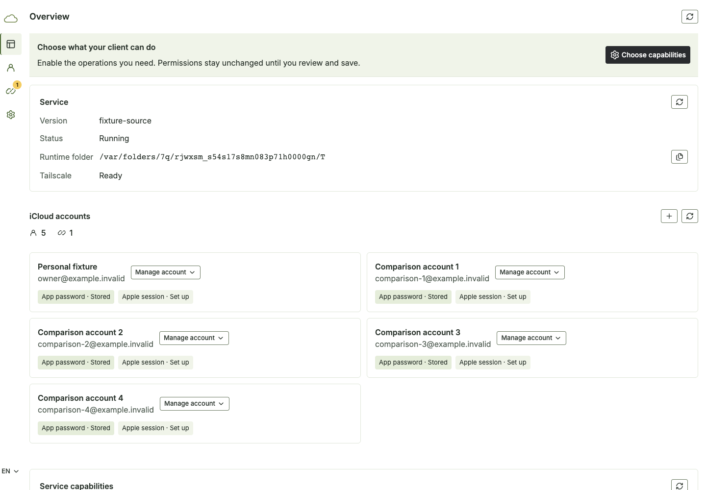 |
| 2 | Compare five account identities and state | Two columns, three rows; verified | 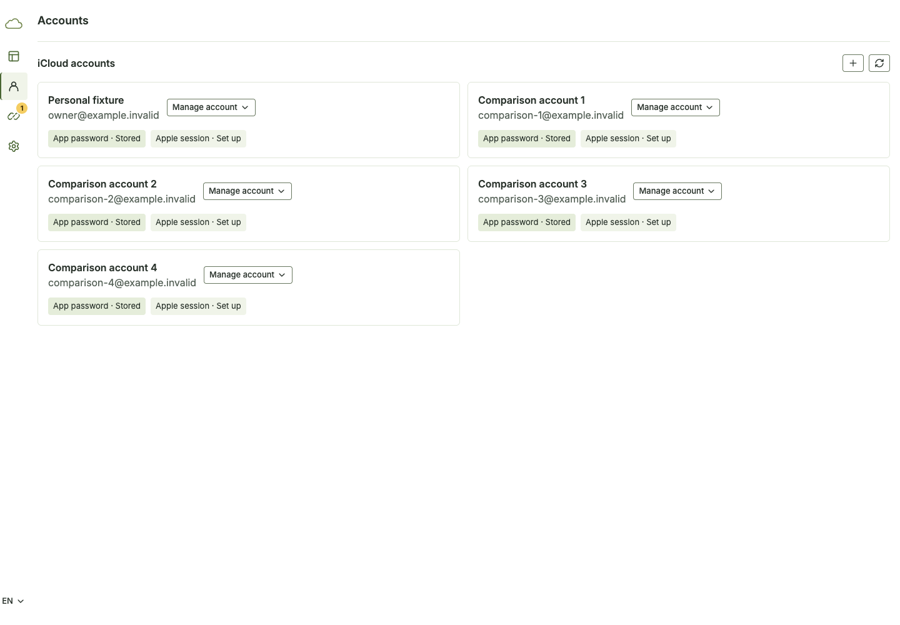 |
| 3 | Understand the next action on touch | Readable title, explanation and explicit CTA; verified | 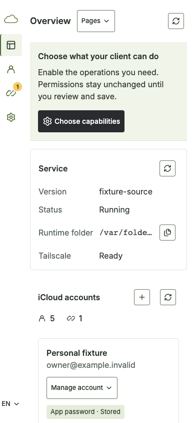 |
| 4 | Maintain the correct account on touch | One column and individually contextual actions; verified | 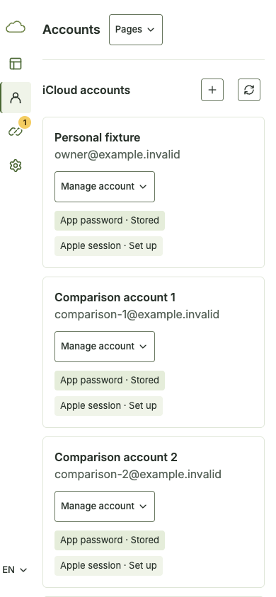 |
| 5 | Correct a rejected credential | Linked form-level explanation; secret cleared; verified | 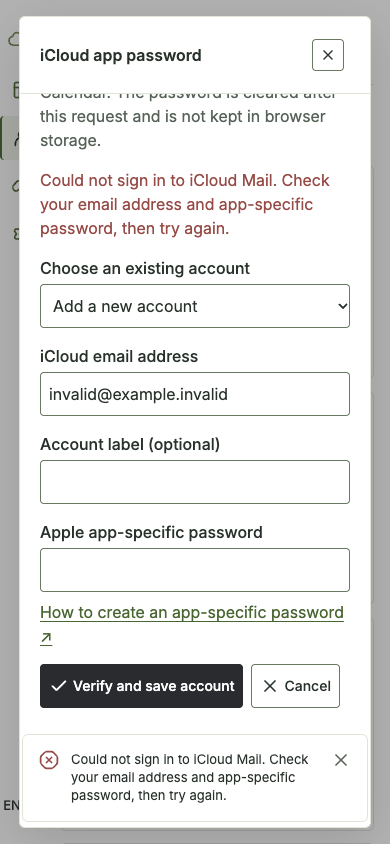 |
| 6 | Discover and switch named destinations | Catalog Pages menu, guarded persistent navigation; verified | 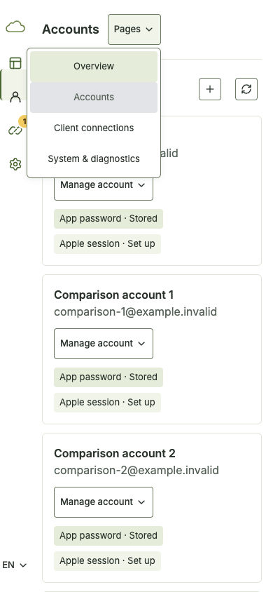 |
| 7 | Continue recovery after dismissing notification | Explanation remains in the form; verified | 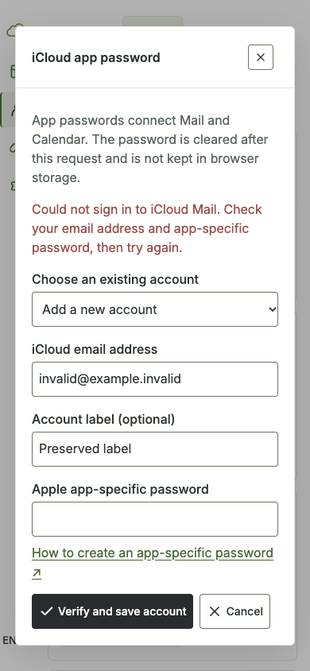 |
| 8 | Read task guidance in Traditional Chinese | Locale/content agree and wrap; verified | 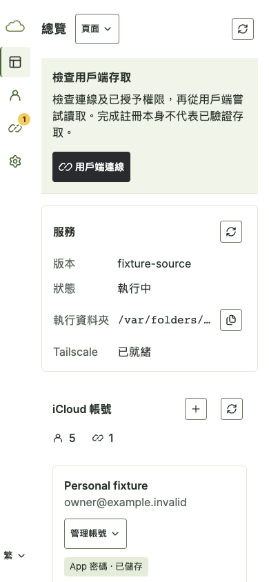 |

## Comparable baseline

| Screen | Before this run | After this run |
| --- | --- | --- |
| Account comparison | 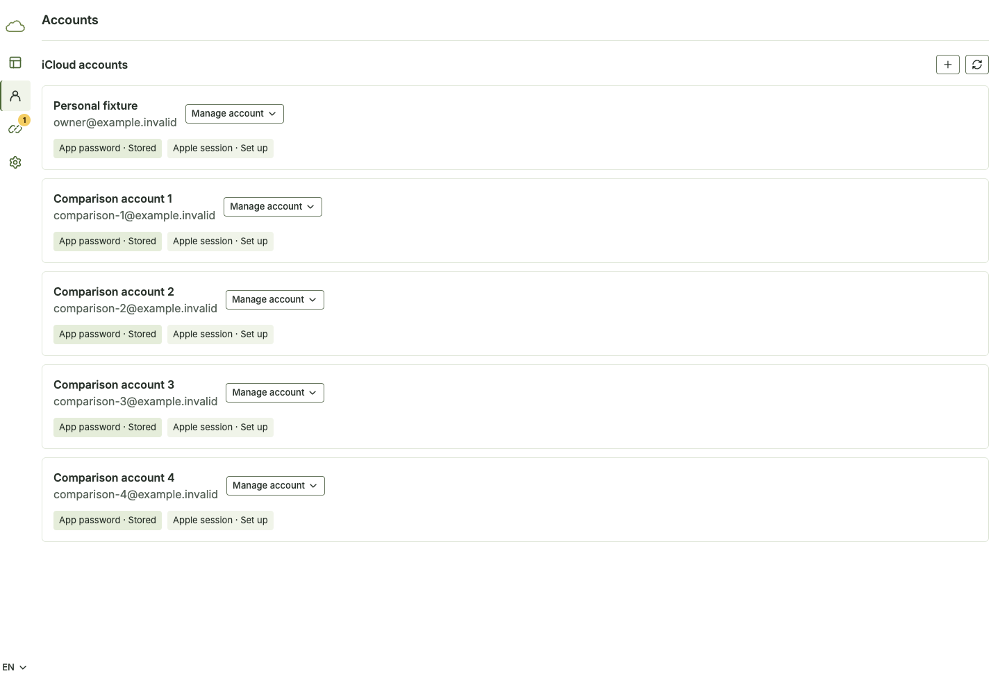 |  |
| Touch entry | 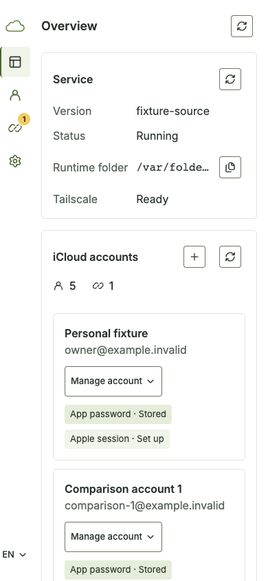 |  |
| Credential recovery | 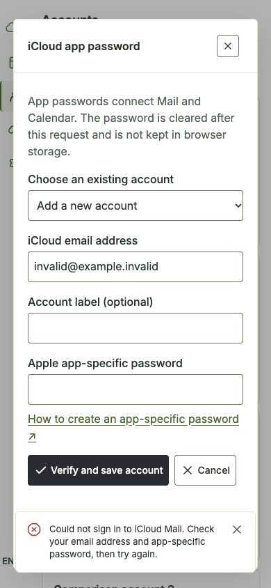 |  |

## Delivery and limits

The assigned task branch and private preview are retained for review. This round
closes the four open findings within the documented local acceptance, not an award
or full accessibility claim. Other legacy Select/FieldLabel adoption and real-device
checks remain broader work. No push, PR, merge or native deployment was requested;
remote CI is not run for this local milestone. Accepted images and the new reusable
`apps/e2e/browser/task-entry-flow.ts` preserve the evidence; owned raw files may be
removed after reconciliation without removing the live review preview.

The review fixture is retained as a detached task process rather than a foreground
command session. After its launcher exited, readback confirmed parent PID 1, its
own process group, and HTTPS session/admin 200. No launch agent, installation or
global startup configuration was added. Its PID, listener and owned log are recorded
in ignored task state; it remains a review preview and is not restart-on-boot hosting.
